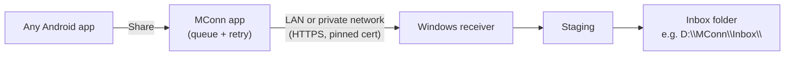

# MConn

Share a file from any Android app, choose **MConn**, and it lands in a folder on your Windows PC. MConn is designed to grow into a multi-provider delivery platform: it can transfer a file from the phone, or—when a supported, authorized source permits it—send a reference so the PC retrieves the file directly.

> **Status:** implementation in progress. See [ROADMAP.md](docs/ROADMAP.md) for the current phase.

## What it does

- **Share-sheet delivery:** works from any app that can share a file (downloads, ZIPs, scripts, documents).
- **Local transfer:** phone and PC on the same Wi-Fi, even with no internet.
- **Remote transfer:** phone and PC on different networks, using a private network (Tailscale) in the first version.
- **Deferred transfer:** if the PC is off or unreachable, the phone keeps the file and delivers it when the PC is back.
- **Automatic acceptance:** pair your phone once with a QR code; after that, files from it are accepted without prompts.
- **Safe delivery:** every file is hash-verified, committed atomically, never overwrites existing files, and is never duplicated by a double-send.
- **Extensible sources:** Share-sheet files, accessible download URLs, browser integration, and provider-specific adapters feed one delivery engine. An adapter never promises access that its provider does not authorize.

## How it works



1. The file is copied into the app's private queue and fingerprinted (SHA-256).
2. The app finds the PC on the LAN, or through the private network.
3. The PC checks the phone is paired and not revoked.
4. The file uploads to a staging folder, is verified, then moved atomically into the inbox.
5. The PC returns a receipt; only then does the phone mark it delivered and clean up.

The phone owns the pending queue. The PC owns the inbox and the record of what was delivered.

## Delivery sources and providers

MConn has one transfer engine, not one transport per AI provider. Each source adapter declares whether it can list files, accept a shared/download URL, retrieve a specific authorized file, or access any history. The default and safest capability is an explicit file or URL selected by the user.

When an adapter supplies an authorized reference, the PC retrieves the bytes directly from that source and then applies the usual hash verification and atomic inbox commit. If direct retrieval is unavailable, MConn falls back to copying the selected file from the phone. Provider adapters never scrape conversations, bypass access controls, or treat account exports as live retrieval APIs.

## Components

| Part | Technology |
| --- | --- |
| Android app | Kotlin, Jetpack Compose, Room, WorkManager |
| Windows receiver | Python, FastAPI, SQLite |
| Transport | HTTPS with resumable uploads |
| Local discovery | mDNS/DNS-SD with manual address fallback |
| Remote access (v1) | Tailscale (WireGuard) |
| Windows startup | Task Scheduler at logon |

## Security at a glance

- The PC is the only authority on who may upload; any phone can be revoked from Windows.
- Pairing uses a short-lived single-use QR code and explicit approval on the PC.
- The phone pins the receiver's certificate fingerprint from the QR code.
- Requests are signed by a non-exportable key in the Android Keystore, with timestamp and nonce replay protection.
- The phone never chooses file paths; filenames are sanitised on the PC.
- Received files are stored, never executed or opened.

Details: [ARCHITECTURE.md §6](docs/ARCHITECTURE.md).

## Getting started

Setup instructions will be added as the first phases land. Planned shape:

1. **PC:** install and start the receiver, choose the inbox folder, and allow the firewall rule.
2. **Phone:** install the MConn app.
3. **Pair:** on the PC choose *Pair new phone*, scan the QR code on the phone, and approve on the PC.
4. **Send:** open any file, tap Share, choose MConn.

For remote use, install Tailscale on both devices and sign in to the same network (planned for Phase 3). On Android, Tailscale uses the system VPN slot, so it cannot run alongside another VPN.

## Known limitations (v1)

- Windows receives only while you are logged in (Task Scheduler at logon).
- One PC per phone; phone-to-PC direction only.
- Remote transfer requires Tailscale on both devices.
- Android may delay background uploads because of battery and scheduling rules; delivery is reliable but not instantaneous.

## Repository layout

```
MConn/
├── android/app/{share,pairing,transfer,queue,ui}/
├── windows-receiver/{api,pairing,transfer,storage,database}/ + main.py
├── protocol/transfer-contracts.md
├── tests/{integration,failure-recovery}/
└── docs: README, ARCHITECTURE, DESIGN, DATABASE.mmd, ROADMAP, AGENTS
```

## Documentation

| Document | Read it for |
| --- | --- |
| [ARCHITECTURE.md](docs/ARCHITECTURE.md) | Components, ownership, security model, decisions |
| [DESIGN.md](docs/DESIGN.md) | User flows, protocol and API, file handling, retry policy |
| [DATABASE.mmd](docs/DATABASE.mmd) | Data models for phone and PC (Mermaid ER diagram) |
| [ROADMAP.md](docs/ROADMAP.md) | Phases, deliverables, exit criteria, acceptance tests, risks |
| [AGENTS.md](AGENTS.md) | Rules and invariants for AI agents and contributors |

## Contributing

Read [AGENTS.md](AGENTS.md) first. It defines the invariants that must never be broken, the testing expectations, and when to ask before changing the protocol or schema.
