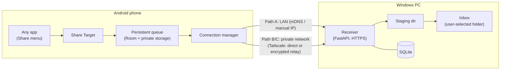
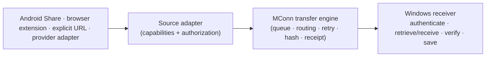
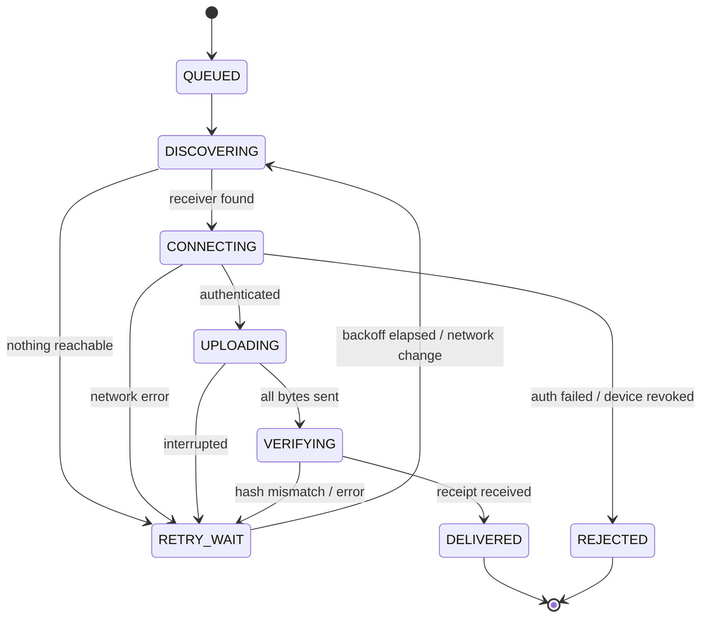

# MConn — Architecture

> Scope of this document: **what the system is made of, who owns what, and why.**
> For behaviour, protocol and UX detail see [DESIGN.md](DESIGN.md). For data models see [DATABASE.mmd](DATABASE.mmd). For sequencing see [ROADMAP.md](ROADMAP.md).

## 1. Purpose

MConn delivers files into a chosen folder on a Windows PC. The initial path is an Android Share Target: the user picks MConn and the selected file appears in the PC inbox (for example `D:\MConn\Inbox\`). The architecture also supports authorized source references—such as an accessible download URL—so the PC can retrieve bytes directly when a source explicitly permits it.

### Goals

1. **Share-sheet delivery:** any Android app can send a file to MConn via the system Share menu.
2. **Local-first:** works on the same Wi-Fi with no internet at all.
3. **Reliable and idempotent:** double-sends, dropped connections and PC restarts never corrupt or duplicate the destination.
4. **Deferred delivery:** if the PC is off or unreachable, the phone keeps the file and delivers it later.
5. **Automatic acceptance** from a paired phone, with the PC as the sole authority over trust.
6. **No cloud file storage.** Any relay only forwards encrypted bytes.
7. **Provider-neutral delivery:** source-specific adapters feed one persistent transfer engine and do not dictate inbox or commit behavior.

### Non-goals (v1)

- Windows → phone transfers, folder sync, or two-way sync.
- Multiple PCs per phone, or multi-user accounts.
- iOS, macOS or Linux clients.
- Building our own NAT traversal or relay infrastructure.
- Executing, previewing or scanning received files.
- Unrestricted access to consumer AI conversations, account exports, or provider history.
- Scraping, credential collection, or bypassing a provider's access controls.

## 2. System context



## 3. Components

### 3.1 Android app (Kotlin + Jetpack Compose)

| Module | Responsibility |
| --- | --- |
| `share` | Receives `ACTION_SEND` / `ACTION_SEND_MULTIPLE`, copies content into app-private storage, enqueues. |
| `pairing` | Scans pairing QR, generates device keypair, completes claim, stores PC identity and pinned certificate fingerprint. |
| `queue` | Room database and private outgoing directory. Single source of truth for pending transfers on the phone. |
| `transfer` | Connection manager, HTTP client, upload logic, retry policy, WorkManager workers. |
| `ui` | Compose screens: queue/status, pairing, settings. |

### 3.2 Windows receiver (Python + FastAPI)

| Module | Responsibility |
| --- | --- |
| `api` | HTTPS endpoints, request authentication, error mapping. |
| `pairing` | Short-lived pairing sessions, QR payload generation, device approval and revocation. |
| `transfer` | Upload sessions, offset tracking, size and hash verification, receipts. |
| `storage` | Staging directory, filename sanitisation, conflict resolution, atomic move into inbox. |
| `database` | SQLite access and migrations. |
| `main.py` | Startup, TLS certificate bootstrap, mDNS advertisement, config loading. |

### 3.3 Connection manager (phone side)

Attempts paths in a fixed order and stops at the first reachable receiver:

| Order | Path | Description |
| --- | --- | --- |
| A | Direct LAN | mDNS/DNS-SD discovery, falling back to the last known or manually entered LAN address. |
| B | Direct remote | Tailscale/WireGuard peer-to-peer connection to the PC's private-network address. |
| C | Relayed remote | Tailscale's encrypted relay (DERP) when direct connection is impossible. Forwards ciphertext only; stores nothing. |

Paths B and C are transparent to MConn: both appear as the same private-network address. MConn does not implement NAT traversal or relay logic in v1.

## 4. Ownership and source of truth

| Concern | Owner | Notes |
| --- | --- | --- |
| Pending transfers and their retry state | **Phone** | Phone deletes its queued copy only after receiving a valid receipt. |
| Destination folder contents | **PC** | Nothing else writes into the inbox. |
| Record of committed files | **PC** | A transfer is "delivered" only when the PC says so. |
| Trust (who may upload) | **PC** | Phone cannot grant itself access; PC can revoke at any time. |
| Destination path and final filename | **PC** | The phone never supplies a filesystem path. |
| Authorized-source credentials | **Their owning platform** | MConn uses only supported authorization; it neither stores provider passwords nor bypasses consent. |

## 4.1 Source adapters and common delivery engine

Every input is normalized into a delivery job before it reaches the receiver's storage layer:



An adapter declares its capabilities explicitly: it may accept an explicit file, a user-selected download URL, retrieve a specific file through an approved API, or list eligible files. A missing capability is not inferred by the UI.

**Reference-first rule:** if an authorized source gives MConn a stable, user-approved reference, the PC retrieves bytes directly from that source. This avoids duplicating a large file through phone storage. If no such retrieval method exists, the Android share path streams the selected file through the existing staged upload protocol. Both paths converge before final verification, filename sanitisation, conflict resolution, atomic commit, and receipt creation.

Provider adapters are intentionally isolated from the transfer engine. A ChatGPT, Claude, Gemini, or future adapter must use only that provider's supported retrieval mechanism and declare its limits. Shared links and browser-assisted user actions are valid generic inputs; account export is not a live retrieval API, and no adapter may claim access to arbitrary consumer-chat history.

## 5. Delivery lifecycle



Steps:

1. **Share and enqueue:** copy the file into app-private storage, generate a transfer ID (UUIDv4), compute SHA-256, insert a `QUEUED` row.
2. **Discover and connect:** try Path A, then B/C. If nothing is reachable, move to `RETRY_WAIT`.
3. **Authenticate:** the PC verifies the paired device's signature and that it is not revoked.
4. **Upload to staging:** stream bytes into a receiver-controlled staging directory, tracking the received offset.
5. **Verify and commit:** check size and SHA-256, sanitise filename, resolve conflicts, atomically move into the inbox, record the commit.
6. **Acknowledge:** the PC returns a receipt. Only then does the phone mark `DELIVERED` and schedule cleanup of its private copy.

**Idempotency:** the transfer ID is the idempotency key. If the PC has already committed that ID, it returns the existing receipt and creates nothing new.

## 6. Security architecture

| Threat | Mitigation |
| --- | --- |
| Unpaired device uploads files | All `/v1` endpoints except pairing claim require a registered, non-revoked device identity. |
| Eavesdropping or tampering on LAN | HTTPS with a receiver-generated self-signed certificate; its SHA-256 fingerprint is delivered in the pairing QR and **pinned** by the phone. |
| Eavesdropping across networks | Same pinned TLS, running inside Tailscale's WireGuard tunnel. Relays see only ciphertext. |
| Stolen or replayed requests | Each request is signed by the device key and carries a timestamp and nonce; the PC rejects stale or reused nonces. |
| Pairing hijack | Pairing token is single-use, short-lived (default 5 minutes), and the PC requires explicit on-screen confirmation of the device. |
| Path traversal / hostile filenames | Phone never sends paths. PC strips directory components, reserved Windows names and illegal characters, and enforces length limits. |
| Disk exhaustion | Per-file size limit, staging quota, and free-space check before accepting an upload. |
| Malicious file content | Files are stored only. MConn never executes, opens or parses them. |
| Receiver exposed to the internet | Receiver binds to LAN and private-network interfaces only. Windows Firewall rule is scoped to private profile and Tailscale. |
| Lost phone | Revoke the device from the Windows app; subsequent requests receive `403 DEVICE_REVOKED`. |

Key storage: the phone's private key lives in the Android Keystore (non-exportable). The PC stores only public keys and a hash of pairing tokens.

## 7. Technology stack

| Layer | Choice | Rationale |
| --- | --- | --- |
| Android UI and logic | Kotlin, Jetpack Compose | Native Share Target and background APIs. |
| Phone persistence | Room (SQLite) + app-private files | Survives process death and reboot. |
| Background work | WorkManager (+ foreground service for large uploads) | Persistent, constraint-aware retries. Not an instant-delivery guarantee. |
| Discovery | mDNS/DNS-SD plus manual address | mDNS alone is unreliable on some networks. |
| Transport | HTTPS, resumable uploads | Simple, debuggable, firewall-friendly. |
| Receiver | Python, FastAPI, Uvicorn | Fast to build; clear async streaming. |
| PC persistence | SQLite | Zero-ops, transactional. |
| Windows startup | Task Scheduler (run at user logon) | Simple first step. A Windows Service may replace it later. |
| Remote access | Tailscale (WireGuard) | Avoids building NAT traversal, relay and identity infrastructure in v1. |

## 8. Runtime and deployment

- **PC:** a Python process started by Task Scheduler at user logon. Config file defines inbox path, port, size limit and staging path. Logs go to a rolling file. The receiver is not available while the user is logged out; this is an accepted v1 limitation.
- **Phone:** a single APK, sideloaded or distributed through a store later. Minimum Android version to be fixed in Phase 1.
- **Network:** receiver listens on a fixed configurable port. On first run, setup adds a private-profile inbound firewall rule.

## 9. Failure modes

| Failure | Expected behaviour |
| --- | --- |
| PC off or asleep | Transfer stays `RETRY_WAIT`; retried on network change, app open, or backoff timer. |
| Wi-Fi drops mid-upload | Upload pauses; on retry the phone asks the PC for the received offset and continues. |
| PC restarts mid-upload | Staging file and offset persist; upload resumes. Incomplete staging data is purged after a timeout. |
| Phone sends the same transfer twice | Second request returns the existing receipt; no duplicate file. |
| Receipt lost after commit | Phone retries; PC returns the stored receipt. |
| Hash mismatch | Staging file discarded, transfer restarts from zero, error surfaced after repeated failures. |
| Filename already exists | Never overwrite. New file is stored with a numeric suffix. |
| Device revoked | Transfer moves to `REJECTED` and is shown to the user with the reason. |
| Android kills background work | WorkManager reschedules; queue state is in Room, not in memory. |

## 10. Architecture decisions

| ID | Decision | Alternatives considered | Reason |
| --- | --- | --- | --- |
| AD-1 | Local-first, remote later | Remote-first with relay | Smallest path to a working product; remote is an add-on. |
| AD-2 | Phone owns queue, PC owns commits | Server-side queue | Keeps the PC simple and the "no cloud storage" promise. |
| AD-3 | Tailscale for remote in v1 | Own relay, WebRTC + TURN | Remote networking is a large project in its own right. Revisit after v1. |
| AD-4 | Self-signed cert pinned via QR | Public CA, plain HTTP on LAN | No public name on a LAN; pinning gives strong trust with no CA. |
| AD-5 | Transfer ID as idempotency key | Hash-based dedup | Same file sent intentionally twice should still be a distinct transfer. |
| AD-6 | PC chooses all paths | Client-supplied paths | Eliminates path traversal by construction. |
| AD-7 | Never overwrite on conflict | Overwrite, prompt | Safe by default and works with no user present. |

## 11. Open questions

1. Minimum supported Android version.
2. Whether to ship a tray UI on Windows in v1 or use a CLI plus local web page for pairing and revocation.
3. Staging timeout and default maximum file size.
4. Long term: replace Tailscale with an integrated transport (WebRTC data channels with signalling and TURN)?

## 12. Repository layout

```
MConn/
├── android/app/{share,pairing,transfer,queue,ui}/
├── windows-receiver/{api,pairing,transfer,storage,database}/ + main.py
├── protocol/transfer-contracts.md
├── tests/{integration,failure-recovery}/
├── ARCHITECTURE.md  DESIGN.md  DATABASE.mmd  ROADMAP.md  AGENTS.md  README.md
```

Rule: networking, transfer state and filesystem operations stay in separate modules so the remote transport can be replaced without touching the Share Target or queue.
