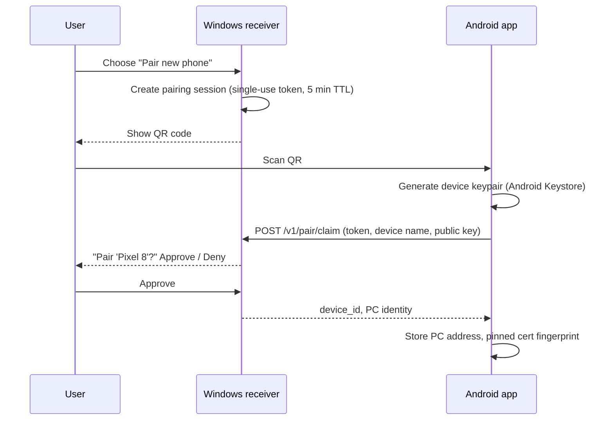

# MConn — Design

> Scope: **how MConn behaves** — user flows, pairing, protocol, API, file handling, retry policy and UI.
> Structure and rationale are in [ARCHITECTURE.md](ARCHITECTURE.md). Data models are in [DATABASE.mmd](DATABASE.mmd).

Items marked **(proposed)** are design choices made in this document that have not yet been validated by implementation.

## 1. User experience principles

1. **One gesture:** Share → MConn. No extra prompts in the normal case.
2. **Never lose a file silently.** Every queued file has a visible state until it is delivered or the user dismisses it.
3. **Explain failures plainly.** "PC unreachable, will retry" beats a stack trace.
4. **Pair once.** After pairing nothing asks for confirmation again.

## 2. User flows

### 2.0 Delivery-source selection

MConn accepts four planned input forms: an Android shared file, an explicit accessible download URL, a browser-extension handoff, or a provider-specific adapter. The UI shows the source capability before creating a job: **transfer from phone**, **PC retrieves this file**, or **not supported**. It never implies that a provider integration can browse a user's conversations or files unless that capability is explicitly authorized and implemented.

For a PC-retrieved source, the phone sends a reference and optional integrity metadata, not file bytes. The receiver authenticates the paired device, retrieves the source through the user's approved authorization, verifies the result, and commits it with the same atomic storage rules as an upload. If direct retrieval is unavailable, the user can select the file and use the ordinary share transfer.

### 2.1 First-time setup (PC)

1. Install and start the receiver.
2. Choose the inbox folder (default `D:\MConn\Inbox\` if the drive exists, otherwise `%USERPROFILE%\MConn\Inbox\`) **(proposed)**.
3. Receiver generates its TLS key and self-signed certificate if none exist, then adds the firewall rule.
4. Receiver is set to start at logon via Task Scheduler.

### 2.2 Pairing



**QR payload** (JSON, base64url-encoded):

| Field | Meaning |
| --- | --- |
| `v` | Payload version, `1` |
| `pc_id` | Stable receiver ID |
| `pc_name` | Display name |
| `hosts` | List of reachable addresses: LAN IP(s), optional Tailscale name or IP |
| `port` | Receiver port |
| `cert_sha256` | Fingerprint of the receiver certificate, pinned by the phone |
| `token` | Single-use pairing token |
| `exp` | Expiry (Unix seconds) |

Pairing is rejected if the token is expired, already used, or the user denies on the PC.

### 2.3 Sending a file

1. User taps Share in any app and selects MConn.
2. MConn shows a minimal confirmation sheet with file name, size and PC status, then dismisses itself **(proposed: skippable setting for "send immediately")**.
3. File is copied into private storage and queued. A notification shows progress.
4. On `DELIVERED` the notification becomes "Delivered to *PC name*". The private copy is cleaned up after a retention period (default 24 hours) **(proposed)**.

Multiple files (`ACTION_SEND_MULTIPLE`) are queued as independent transfers.

### 2.4 Deferred delivery

If no receiver is reachable the transfer shows "Waiting for PC". It is retried when: the app is opened, connectivity changes, the backoff timer fires, or the user taps Retry.

### 2.5 Revoking a phone

On the PC, the user selects a device and chooses Revoke. Further requests from that device return `403 DEVICE_REVOKED`. The phone shows affected transfers as `REJECTED` with the reason.

## 3. Android design

### 3.1 Screens

| Screen | Content |
| --- | --- |
| Transfers | List grouped by Active / Waiting / Delivered / Failed. Each row: name, size, state, progress, last error. Actions: retry, cancel, remove. |
| Pairing | Camera QR scanner and manual address entry. |
| Settings | PC name and status, retention period, cellular allowed toggle, "send immediately" toggle. |

### 3.2 Share Target

Manifest intent filters accept `ACTION_SEND` and `ACTION_SEND_MULTIPLE` for `*/*`. Content is read through `ContentResolver`; no storage permission is required for shared URIs. The file is streamed to private storage while the SHA-256 is computed in the same pass.

### 3.3 Queue and background execution

- Room is the only source of truth for transfer state.
- A unique `TransferWorker` per transfer ID runs under WorkManager with a network constraint.
- Large uploads run as expedited work or a foreground service so the OS does not terminate them **(proposed threshold: files larger than 25 MB)**.
- Retry backoff is exponential: 15 s, 30 s, 1 min, 2 min, 5 min, then every 15 min, capped. Network changes and app-open events reset the delay.
- After app update or reboot, workers are re-enqueued from Room.
- Cellular data is **off by default**; the user can allow it for remote transfers **(proposed)**.

### 3.4 Connection selection

```
for host in [last_successful_host, mdns_results, lan_hosts_from_pairing, private_network_hosts]:
    if GET /v1/device/status succeeds within 3s with pinned cert: use host
if none: RETRY_WAIT
```

The successful host is remembered and tried first next time.

## 4. Windows design

### 4.1 Receiver process

- Loads config, opens SQLite, runs migrations, creates staging and inbox directories.
- Advertises `_mconn._tcp` over mDNS with `pc_id` in the TXT record.
- Serves HTTPS with the pinned certificate.
- A background task purges abandoned staging files after 24 hours **(proposed)**.

### 4.2 Management UI (open question)

v1 needs three actions: start pairing (show QR), list devices, revoke device. Preferred approach **(proposed)**: a local-only web page at `https://127.0.0.1:<port>/admin`, reachable only from loopback, so no separate GUI toolkit is required. A tray app can follow later.

### 4.3 Configuration

| Key | Default | Meaning |
| --- | --- | --- |
| `inbox_dir` | see 2.1 | Final destination |
| `staging_dir` | `<inbox_dir>\.staging` | Temporary uploads, same volume as inbox so the final move is atomic |
| `port` | `8443` | HTTPS port |
| `max_file_bytes` | 4 GiB | Per-file limit |
| `min_free_bytes` | 1 GiB | Reject uploads leaving less free space than this |
| `pairing_ttl_seconds` | 300 | QR validity |
| `staging_ttl_hours` | 24 | Abandoned upload cleanup |

## 5. Protocol

Transport: HTTPS, JSON for metadata, raw bytes for content. All routes are under `/v1`. (The earlier draft listed `/pair/claim`; it is now `/v1/pair/claim` for consistency.)

`/v1` currently defines only the phone-to-PC upload path. Source-reference retrieval and provider adapters are future additive, versioned endpoints; they must not accept account passwords, raw provider session cookies, or opaque conversation access claims.

### 5.1 Request authentication

Every request except `POST /v1/pair/claim` carries:

| Header | Meaning |
| --- | --- |
| `X-MConn-Device` | `device_id` |
| `X-MConn-Timestamp` | Unix seconds |
| `X-MConn-Nonce` | Random 128-bit value, base64url |
| `X-MConn-Signature` | ECDSA P-256 signature over `METHOD \n PATH \n TIMESTAMP \n NONCE \n BODY_SHA256` |

The PC rejects timestamps more than 5 minutes off and any nonce seen within that window. For streamed content uploads the body hash field is the literal `UNSIGNED-PAYLOAD` and integrity is enforced by the transfer's declared SHA-256 and the TLS channel **(proposed)**.

### 5.2 Endpoints

| Method and path | Purpose | Success |
| --- | --- | --- |
| `POST /v1/pair/claim` | Complete pairing with token and public key | `200` with `device_id`, `pc_id` |
| `GET /v1/device/status` | Reachability and trust check | `200` `{pc_id, device_status, accepting}` |
| `POST /v1/transfers` | Create or look up a transfer | `201` new, `200` existing |
| `PUT /v1/transfers/{id}/content` | Upload bytes from an offset | `200` `{bytes_received}` or final receipt |
| `GET /v1/transfers/{id}` | Status, received offset, receipt | `200` |
| `GET /v1/inbox?limit=` | Recent deliveries | `200` |

### 5.3 Create transfer

Request:

```json
{
  "transfer_id": "3f6c0d52-8a1e-4d39-9b52-4c7e1d6f2a10",
  "name": "report.zip",
  "size": 12345678,
  "sha256": "9f86d081884c7d659a2feaa0c55ad015a3bf4f1b2b0b822cd15d6c15b0f00a08",
  "mime": "application/zip"
}
```

Response:

```json
{
  "transfer_id": "3f6c0d52-8a1e-4d39-9b52-4c7e1d6f2a10",
  "state": "UPLOADING",
  "bytes_received": 0,
  "max_chunk_bytes": 8388608
}
```

If the ID is already `COMMITTED`, the response is `200` with `state: "COMMITTED"` and the receipt, and the phone skips uploading.

### 5.4 Upload content

```
PUT /v1/transfers/{id}/content
Upload-Offset: 4194304
Content-Type: application/octet-stream
Content-Length: <n>
```

- The PC rejects the request with `409 OFFSET_MISMATCH` (including the true offset) if `Upload-Offset` differs from its stored offset.
- The phone resumes by calling `GET /v1/transfers/{id}` to read `bytes_received`, then continuing from there.
- **MVP:** a single `PUT` with offset 0 uploads the whole file. Chunking uses the same endpoint, so no protocol change is needed later.
- When `bytes_received == size`, the PC verifies, commits, and returns the receipt in the same response.

### 5.5 Receipt

```json
{
  "transfer_id": "3f6c0d52-8a1e-4d39-9b52-4c7e1d6f2a10",
  "state": "COMMITTED",
  "stored_name": "report (1).zip",
  "size": 12345678,
  "sha256": "9f86d081...",
  "committed_at": "2026-10-24T10:15:30Z"
}
```

The receipt never includes the absolute PC path.

### 5.6 Errors

Error body: `{"error": "<CODE>", "message": "<human text>", "retryable": true|false}`.

| HTTP | Code | Retryable | Meaning |
| --- | --- | --- | --- |
| 400 | `INVALID_REQUEST` | no | Malformed metadata |
| 401 | `BAD_SIGNATURE` / `STALE_REQUEST` | no / yes | Auth failure; stale means clock skew or replay |
| 403 | `DEVICE_REVOKED` / `DEVICE_UNKNOWN` | no | Phone not trusted |
| 404 | `TRANSFER_NOT_FOUND` | no | Unknown ID |
| 409 | `OFFSET_MISMATCH` | yes | Re-sync with returned offset |
| 413 | `FILE_TOO_LARGE` | no | Exceeds limit |
| 422 | `HASH_MISMATCH` | yes (restart) | Content did not match declared hash |
| 507 | `INSUFFICIENT_STORAGE` | yes | Low disk space on PC |
| 503 | `NOT_ACCEPTING` | yes | Receiver paused or shutting down |

## 6. File handling on the PC

1. Stream upload into `staging_dir/<transfer_id>.part` and fsync on completion.
2. Verify size, then SHA-256.
3. **Sanitise the name:** take the base name only; replace `< > : " / \ | ? *` and control characters; reject or rename reserved names (`CON`, `NUL`, `COM1` ...); trim trailing dots and spaces; limit to 200 characters while preserving the extension; fall back to `file` if empty.
4. **Resolve conflicts:** if the name exists, append ` (1)`, ` (2)` ... before the extension. Never overwrite.
5. Atomically move into `inbox_dir` (`os.replace` on the same volume), then record `COMMITTED` and the final name in one database transaction. Name selection and the move are serialised by a lock.
6. Return the receipt.

On startup the receiver reconciles: any `.part` file without a matching active transfer is deleted; any transfer marked `COMMITTED` whose file is missing is left as is and flagged in logs (the user may have moved or deleted it).

## 7. State definitions

| State (phone) | Meaning |
| --- | --- |
| `QUEUED` | Stored locally, waiting for a worker |
| `DISCOVERING` | Looking for a reachable receiver |
| `CONNECTING` | Receiver found, authenticating and creating the transfer |
| `UPLOADING` | Sending bytes |
| `VERIFYING` | All bytes sent, waiting for the receipt |
| `DELIVERED` | Receipt stored |
| `RETRY_WAIT` | Transient failure, next attempt scheduled |
| `REJECTED` | Permanent failure (revoked, too large, unknown device) |
| `CANCELLED` | User cancelled before delivery |

The PC tracks its own narrower set: `UPLOADING`, `COMMITTED`, `FAILED`.

## 8. Limits and defaults

| Item | Value |
| --- | --- |
| Max file size | 4 GiB |
| Chunk size (post-MVP) | 8 MiB |
| Connection probe timeout | 3 s |
| Request clock skew | ±5 min |
| Pairing TTL | 5 min |
| Private copy retention after delivery | 24 h |
| Max retries | Unlimited, with capped backoff; user can cancel |

## 9. Logging and observability

- **PC:** rolling log file with transfer ID, device ID, state transitions and errors. Never log file contents or signatures.
- **Phone:** per-transfer last error and attempt count kept in Room and shown in the UI. Optional "export diagnostics" action.
- Every state transition is timestamped, which makes failure-recovery tests assertable.

## 10. Edge cases to cover

- Sharing a file from a source that revokes its URI permission quickly: copy immediately, before any UI.
- File shared from a cloud-backed provider that downloads lazily: copy may be slow; show progress during enqueue.
- Phone clock far from PC clock: `STALE_REQUEST`; show a "check your phone's date and time" hint.
- PC IP address changed: mDNS or manual re-entry; remembered host fails fast (3 s) and discovery continues.
- Two phones sending at once: independent transfer IDs and staging files; conflict resolution is serialised.
- Zero-byte files are valid transfers.
- Very long or non-ASCII filenames are preserved where Windows allows, otherwise sanitised.
